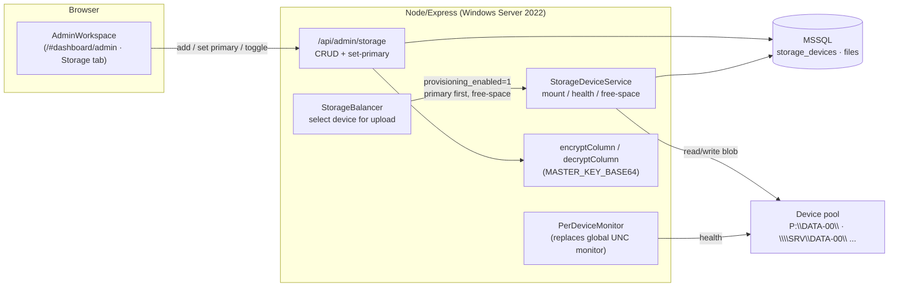

# DESIGN SPEC — MULTI-STORAGE DEVICE POOL

> Companion to ADR-0001. Describes the target architecture for the DB-backed
> storage availability group on the MSSQL branch.

## 1. Target Topology (C4-Container level)

## 2. Components

| Component | Responsibility | Replaces |
|---|---|---|
| `StorageBalancer` | Choose target device for each new upload (auto-balancing) | `FILE_VAULT` constant selection |
| `StorageDeviceService` | Mount (net use), resolve paths, free-space queries | boot-time `net use` block |
| `PerDeviceMonitor` | Per-device reachability → route around / flag | global UNC monitor in `server.ts#L290` |
| `Admin Storage API` | CRUD + set-primary + provisioning toggle | (new) |
| Storage tab (UI) | Ops surface in `/#dashboard/admin` | (new) |
| `Crypto` (existing) | Encrypt/decrypt SMB username & password | plaintext env creds |

## 3. Provisioning Algorithm (auto-balancing)

For each new upload, select a device:

1. Filter `storage_devices WHERE provisioning_enabled = 1`.
2. Prefer `is_primary = 1` if reachable.
3. Otherwise order by ascending free-space ratio (device with most free
   space), fallback round-robin among reachable enabled devices.
4. Store chosen `storage_device_id` on the new `files` row; write blob under
   that device's `storage_path` (path join uses the **device-specific** root,
   not the global `FILE_VAULT`).

> Watermark rule (open): stop sending to a device below a configured
> free-space watermark (e.g. < 10% free). Device stays `provisioning_enabled`
> but is skipped until freed or marked primary-eligible.

### Behavior classes
- **All devices offline & `provisioning_enabled`** → upload fails closed
  (consistent with fail-closed AV posture); admin notified in health tab.
- **Primary offline** → balancer falls to next enabled device (soft failover).

## 4. Per-Device Health Monitor

- Replace the single `FILE_VAULT` reachability check (`server.ts#L290-L334`)
  with a per-device checker.
- A device that becomes unreachable:
  - is excluded from the balancer immediately,
  - surfaced in the Storage tab (status),
  - **does not** flip global maintenance mode (only-allowed behavior when
    **all** devices are down, preserving the existing maintenance-mode
    guardrail when there is nowhere to write).
- `UNC_SHARE_HEALTHCHECK_INTERVAL_MS` semantics stay, but applied per device.

## 5. Design Invariants
- Every blob MUST be resolvable via (device storage_path, files.stored_path).
- `stored_path` remains a **relative** logical name per device (existing
  contract); device identity is the new FK, not embedded in the path.
- SMB credentials are never returned plaintext by the Admin API.
- Exactly one `is_primary` per enabled pool (new primary un-sets old).
- `provisioning_enabled=0` devices must never receive new uploads.

## 6. Diagram Validation
- Mermaid graph validated: ≤ 20 nodes, all edges evidence-backed
  (API↔DB, Balancer→Device, Device→SMB, Monitor→SMB).
