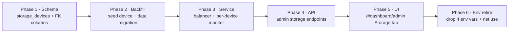

# ROADMAP — MULTI-STORAGE DEVICE POOL (Phased Implementation)

> Trigger: GAP-MANIFEST-MULTI-STORAGE lists 3 P1 + 4 P2 gaps, dependency-heavy.
> Target branch: `mssql`. No code changes in this documentation pass.

## Phase Map

## Phase Detail

### Phase 1 — Schema (GAP-MS-002)
- Create `storage_devices` (+ partial unique index on primary).
- Add nullable `storage_device_id` FK to `files` and `file_versions`.
- **Exit**: migrations apply clean on a fresh + existing DB.

### Phase 2 — Backfill (GAP-MS-008)
- Seed initial device from legacy env values.
- Backfill FK on existing rows; set NOT NULL; add device index.
- **Exit**: every legacy blob resolvable per-device.

### Phase 3 — Service (GAP-MS-001, GAP-MS-006)
- `StorageDeviceService` (mount/net use, resolve per-device roots).
- `StorageBalancer` (primary-first, free-space, round-robin).
- `PerDeviceMonitor` (replace global UNC monitor; only all-down → maintenance).
- Rewrite all `path.join(FILE_VAULT, ...)` tap points.
- **Exit**: upload/write/delete paths fully device-aware; per-device health visible.

### Phase 4 — API (GAP-MS-004 backend)
- CRUD + set-primary + provisioning-toggle admin endpoints.
- Server-side one-primary constraint + delete-refusal with live files.
- **Exit**: endpoints + validation covered; no plaintext creds leak.

### Phase 5 — UI (GAP-MS-004 frontend)
- Add `"storage"` to `AdminTab` union in `admin-workspace.tsx`.
- Storage tab: list devices, add, edit, set primary, toggle provisioning.
- **Exit**: full add/manage flow working; status reflect per-device health.

### Phase 6 — Env Retire (GAP-MS-003, GAP-MS-005)
- Drop the 4 env vars from `.env.example`; remove boot `net use` block.
- Update `production.ts` validation (device-aware).
- Update `cleanup-vault-orphans.ts`, CONFIGURATION-ENV.md.
- **Exit**: clean boot with zero legacy env vars; docs consistent.

## Dependencies
- Service (P3) depends on Schema+Backfill (P1/P2).
- API (P4) depends on Service (P3).
- UI (P5) depends on API (P4).
- Env retire (P6) last — requires all prior.

## Owner Matrix
| Phase | Engineer | Ops | QA |
|---|---|---|---|
| 1 Schema | Backend/DBA | — | validate migration |
| 2 Backfill | Backend | run in maintenance window | verify each row |
| 3 Service | Backend | provision test shares | failover drills |
| 4 API | Backend | — | authz + CRUD tests |
| 5 UI | Frontend | — | UI/flow QA |
| 6 Env retire | Backend | deploy runbook | boot validation |
